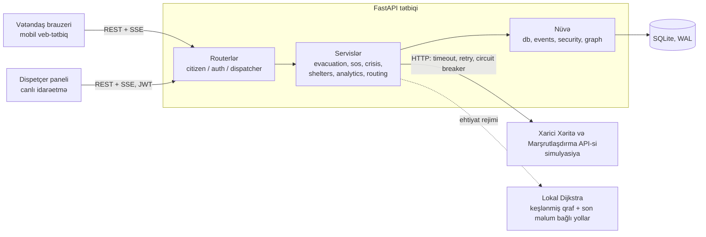
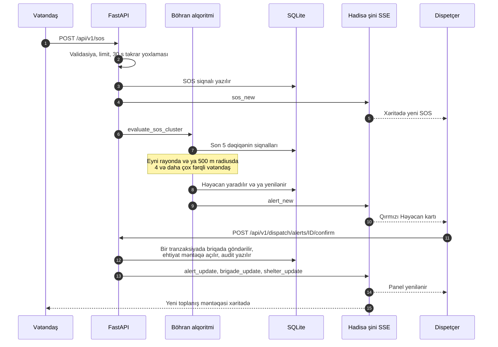

# Urban Crisis & Crowd Evacuation Engine

Bakı şəhəri üçün fövqəladə hallarda **vətəndaşların təxliyəsi** və **xilasetmə qüvvələrinin dispetçer idarəetməsi** üzrə işlək prototip. Vətəndaş ən yaxın toplanış məntəqələrini, onların cari doluluğunu və tövsiyə olunan marşrutu görür, bir toxunuşla SOS göndərir; dispetçer isə canlı paneldə vəziyyəti izləyir və "Qırmızı Həyəcan" qərarını bir kliklə təsdiqləyir. Backend (Python / FastAPI / SQLite) və frontend eyni tətbiq tərəfindən təqdim olunur; xarici xəritə və marşrutlaşdırma API-si simulyasiya edilir.

| Səhifə | Ünvan | Təyinat |
|---|---|---|
| Rol seçimi | <http://localhost:8000/> | Giriş səhifəsi |
| Vətəndaş tətbiqi | <http://localhost:8000/citizen> | Modul 1 — mobil cihaz üçün nəzərdə tutulmuş veb-tətbiq |
| Dispetçer paneli | <http://localhost:8000/dispatcher> | Modul 2 — canlı idarəetmə paneli (giriş tələb olunur) |
| API sənədləri | <http://localhost:8000/docs> | Swagger UI |

> **Qeyd.** Yol şəbəkəsi, toplanış məntəqələri və briqadalar haqqında məlumat **simulyasiya olunmuş / təxminidir** (bax: [Məhdudiyyətlər](#məhdudiyyətlər-və-gələcək-inkişaf)).

---

## Sürətli başlanğıc

### Windows

`run.bat` faylına iki dəfə klikləyin (Python 3.10+ quraşdırılmış olmalıdır). Skript virtual mühit yaradır, asılılıqları quraşdırır, serveri işə salır və brauzeri açır.

```bash
run.bat
```

### Linux / macOS

```bash
./run.sh
```

### Docker

Əsas tətbiq 8000 portunda, simulyasiya olunmuş xarici API isə ayrı konteynerdə 8001 portunda işləyir.

```bash
docker compose up --build
```

### Əl ilə (istənilən ƏS)

```bash
python -m venv .venv
```

Virtual mühiti aktivləşdirin — Windows:

```bash
.venv\Scripts\activate
```

Linux / macOS:

```bash
source .venv/bin/activate
```

```bash
pip install -r requirements.txt
```

```bash
python -m uvicorn app.main:app --port 8000
```

Docker-siz rejimdə simulyasiya olunmuş xarici API ayrıca proses tələb etmir: o, eyni prosesin daxilində `httpx.ASGITransport` vasitəsilə çağırılır. Kod yolu eynidir (HTTP müştərisi, timeout, retry, circuit breaker), sadəcə şəbəkə istifadə olunmur.

### Ünvanlar

| Nə | Ünvan |
|---|---|
| Rol seçimi | `http://localhost:8000/` |
| Vətəndaş tətbiqi | `http://localhost:8000/citizen` |
| Dispetçer paneli | `http://localhost:8000/dispatcher` |
| Swagger UI | `http://localhost:8000/docs` |
| Sağlamlıq yoxlaması | `http://localhost:8000/health` |
| Xarici API (yalnız Docker) | `http://localhost:8001/docs` |

### Demo hesabları

| İstifadəçi | Parol | Rol |
|---|---|---|
| `dispatcher` | `dispatcher123` | Dispetçer |
| `admin` | `admin123` | Administrator (bütün icazələr) |

Bunlar **yalnız nümayiş üçün** hesablardır. Parollar `UCE_DISPATCHER_PASSWORD` və `UCE_ADMIN_PASSWORD` mühit dəyişənləri ilə dəyişdirilir; real istismarda mütləq dəyişdirilməlidir. Vətəndaş tətbiqi giriş tələb etmir.

---

## Funksionallıq

### Modul 1 — Vətəndaş Təhlükəsizlik Tətbiqi

| Tələb | Reallaşdırma | Harada |
|---|---|---|
| Vətəndaş rayonunu / mövqeyini göstərir | Üç üsul: rayon siyahısı (8 rayon), brauzerin geolokasiyası, xəritədə klik. Rayon seçildikdə onun mərkəz koordinatı götürülür | `/citizen`; `GET /api/v1/meta`, `GET /api/v1/evacuation` |
| Ən yaxın toplanış məntəqələri (sığınacaq, park, stadion) və doluluq faizi | Açıq məntəqələr məsafəyə görə sıralanır; hər biri üçün `occupancy_pct` və səviyyə (`low` / `medium` / `high` / `full` / `critical`) hesablanır. Siyahıda 5 məntəqə göstərilir (`UCE_NEAREST_LIMIT`) | `app/services/shelters.py`, `app/services/evacuation.py`; `GET /api/v1/shelters`, `GET /api/v1/evacuation` |
| Tövsiyə olunan təxliyə marşrutu | Ən yaxın 8 məntəqəyə marşrutlar Xarici Xəritə API-sindən **bir toplu sorğu** ilə alınır; qəbul edən (doluluq < 90%) və marşrutu mövcud olan məntəqələr arasından piyada müddəti ən qısa olan tövsiyə edilir. Cavabda məsafə, müddət, küçə adları üzrə addımlar və xətt nöqtələri var | `app/services/evacuation.py` (`build_plan`), `app/services/routing.py` |
| Avtomatik alternativ marşrut: məntəqə **≥ 90%** dolu və ya **yol bağlı** | Hər vətəndaşın son planı saxlanılır (`evacuation_plans`). Məntəqə 90%-ə çatdıqda və ya planın keçdiyi yol bağlandıqda təsirlənən planlar yenidən hesablanır və yeni marşrut **yalnız həmin vətəndaşa** SSE ilə göndərilir (`reroute` hadisəsi, səbəb: `shelter_full` / `road_closed`). Tətbiqdə xəbərdarlıq zolağı görünür | `app/services/evacuation.py` (`reevaluate_plans`), `app/core/events.py`; `GET /api/v1/stream` |
| Bir toxunuşla SOS, 4 təhlükə növü | Növlər: yanğın (`fire`), uçqun (`collapse`), daşqın (`flood`), tibbi yardım (`medical`). Siqnal koordinata görə ən yaxın rayona aid edilir. Eyni vətəndaşın eyni növ üzrə 30 saniyə ərzində təkrar kliki yeni siqnal yaratmır. Limit: bir vətəndaşdan dəqiqədə 6, bir IP-dən dəqiqədə 30 | `app/services/sos.py` (`create_sos`); `POST /api/v1/sos` |
| "Təhlükəsizəm" statusu | Vətəndaşın aktiv SOS siqnalları bağlanır; məntəqə göstərilibsə, onun doluluğu 1 nəfər artır (bir vətəndaş — bir dəfə), bu da doluluq hədlərinin yoxlanmasını işə salır | `app/services/sos.py` (`set_status`); `POST /api/v1/status` |
| Vətəndaşa əks-əlaqə | SOS-a briqada təyin edildikdə və ya siqnal bağlandıqda vətəndaşa fərdi hadisə göndərilir (`sos_assigned`, `sos_resolved`) | `app/services/sos.py`; `GET /api/v1/citizens/{citizen_id}` |
| Çoxdilli interfeys | AZ / RU / EN dil seçimi; mətnlər `static/js/i18n.js` lüğətlərindədir, API mətn əvəzinə kod qaytarır | `static/js/i18n.js` |

### Modul 2 — Fövqəladə Hallar Dispetçer Paneli

| Tələb | Reallaşdırma | Harada |
|---|---|---|
| Canlı vəziyyət paneli | KPI göstəriciləri (aktiv SOS, gözləyən həyəcanlar, açıq / ehtiyat / dolu məntəqələr, ümumi doluluq, boş briqadalar, bağlı yollar, təhlükəsiz vətəndaşlar), xəritə, rayonlar üzrə cədvəl (risk səviyyəsi ilə), son 30 dəqiqənin SOS axını. Yeniləmələr SSE ilə gəlir, kəsildikdə polling ilə əvəzlənir | `/dispatcher`; `app/services/analytics.py`; `GET /api/v1/dispatch/overview`, `GET /api/v1/dispatch/stream` |
| Kritik Böhran Alqoritmi — qayda A (SOS klasteri) | Son **5 dəqiqədə** **eyni zonadan (rayon)** və ya yeni siqnaldan **500 m radiusda** **ən azı 4 fərqli vətəndaşdan** SOS daxil olubsa, "Qırmızı Həyəcan" yaranır | `app/services/crisis.py` (`evaluate_sos_cluster`) |
| Kritik Böhran Alqoritmi — qayda B (doluluq) | Açıq toplanış məntəqəsinin doluluğu **95%-dən çox** olduqda "Qırmızı Həyəcan" yaranır | `app/services/crisis.py` (`evaluate_shelter`) |
| Xəbərdarlıq: "Əlavə Xilasetmə Briqadası Göndər və Yeni Toplanış Nöqtəsi Aç" | Həyəcan paneldə qırmızı kart kimi görünür. Eyni rayon / məntəqə üçün gözləyən həyəcan təkrarlanmır — mövcud kart yenilənir; qərardan sonra 5 dəqiqə (`UCE_ALERT_COOLDOWN_S`) ərzində eyni obyekt üçün yeni həyəcan yaradılmır | `app/services/crisis.py`; `GET /api/v1/dispatch/alerts` |
| Bir kliklə təsdiq | Tək əməliyyat daxilində (**atomar**): (1) ən yaxın **boş** briqada göndərilir — üstünlük dominant təhlükə növünə uyğun briqadaya verilir (yanğın → yanğınsöndürmə, tibbi → təcili tibbi yardım, uçqun / daşqın → xilasetmə; uyğun növ yoxdursa, ən yaxın istənilən boş briqada); (2) ən yaxın **ehtiyat** toplanış məntəqəsi açılır; (3) klasterdəki SOS siqnalları briqadaya bağlanır; (4) audit jurnalına yazılır. Təsdiq **idempotentdir**: ikinci klik heç nəyi təkrarlamır | `app/services/crisis.py` (`confirm_alert`); `POST /api/v1/dispatch/alerts/{id}/confirm` |
| Həyəcanın rədd edilməsi | Dispetçer həyəcanı əməliyyat aparmadan bağlaya bilər | `POST /api/v1/dispatch/alerts/{id}/dismiss` |
| Ayrı-ayrı SOS siqnallarının idarəsi | Briqadanın təyini (göstərilməyibsə, ən yaxın uyğun boş briqada seçilir) və siqnalın bağlanması | `POST /api/v1/dispatch/sos/{id}/assign`, `.../resolve` |
| Briqadaların idarəsi | 8 briqada (2 yanğınsöndürmə, 3 təcili tibbi yardım, 3 xilasetmə); statusun dəyişdirilməsi | `PATCH /api/v1/dispatch/brigades/{id}` |
| Məntəqələrin idarəsi | Doluluğun və statusun (`open` / `reserve` / `closed`) dəyişdirilməsi; dəyişiklik hədləri yenidən yoxlayır | `PATCH /api/v1/dispatch/shelters/{id}` |
| Yolların bağlanması / açılması | Dispetçerin bağladığı yol dərhal marşrutlardan çıxarılır, təsirlənən vətəndaşlar yenidən marşrutlaşdırılır; bağlanma bazada saxlanılır və yenidən başlatmadan sonra bərpa olunur | `POST /api/v1/dispatch/roads/{edge_id}/close`, `.../open` |
| Audit | Giriş cəhdləri və dispetçerin bütün əməliyyatları jurnala yazılır | `audit_log` cədvəli; `GET /api/v1/dispatch/audit` |
| Demo ssenariləri | "Simulyasiya" menyusu: SOS klasteri, məntəqəni doldur, izdiham, yolu bağla, bütün yolları aç, xarici API kəsintisi / bərpası, sıfırla | `app/services/demo.py`; `POST /api/v1/dispatch/demo/scenario` |

---

## Demo ssenarisi (münsiflər üçün addım-addım)

1. **İki pəncərə açın.** Birində `http://localhost:8000/citizen`, digərində `http://localhost:8000/dispatcher`. Dispetçer panelinə `dispatcher` / `dispatcher123` ilə daxil olun.
2. **Vətəndaş: rayon seçin** (və ya xəritədə klikləyin). Ən yaxın toplanış məntəqələri doluluq faizi ilə, tövsiyə olunan məntəqə isə marşrutu, məsafəsi və piyada müddəti ilə görünür.
3. **Vətəndaş: SOS düyməsini basın** və təhlükə növünü seçin. Siqnal dərhal dispetçer panelinin xəritəsində və SOS siyahısında görünür.
4. **Dispetçer: "Simulyasiya" → "SOS klasteri".** Seçilmiş (seçilməyibsə — təsadüfi) rayonda 4 fərqli vətəndaşdan siqnal yaradılır → qırmızı **"Qırmızı Həyəcan"** kartı çıxır. Kartdakı təsdiq düyməsini bir dəfə basın: ən yaxın uyğun briqada göndərilir, ən yaxın ehtiyat toplanış məntəqəsi açılır (vətəndaş xəritəsində də görünür). Düyməni təkrar basmaq heç nəyi təkrarlamır.
5. **Dispetçer: "Simulyasiya" → "Məntəqəni doldur".** Ssenari göstərilən məntəqəni (göstərilməyibsə — hazırda qəbul edən ən dolu açıq məntəqəni) 97%-ə çatdırır. Planı həmin məntəqəyə yönəlmiş vətəndaşlara **avtomatik alternativ marşrut** göndərilir (vətəndaş pəncərəsində xəbərdarlıq zolağı), doluluq 95%-i keçdiyi üçün paneldə ikinci növ "Qırmızı Həyəcan" da yaranır.
6. **Dispetçer: "Yolu bağla".** Vətəndaşın marşrutunun keçdiyi yol bağlandıqda ona yeni marşrut göndərilir. Dispetçerin birbaşa bağladığı yol dərhal, "Simulyasiya" menyusundan bağlanan yol isə (xarici API tərəfində bağlanır) növbəti sinxronizasiyada — ən çoxu 4 saniyəyə nəzərə alınır.
7. **Dispetçer: "Simulyasiya" → "Xarici API kəsintisi".** Xarici API 503 qaytarmağa başlayır. Marşrutlar fasiləsiz qurulmağa davam edir — bu dəfə lokal Dijkstra ilə, son məlum bağlı yollar nəzərə alınmaqla; plan cavabında `routing.source = "fallback"` olur. Ardıcıl 3 uğursuz çağırışdan sonra (fon sinxronizasiyası 4 saniyədən bir işlədiyi üçün ən çoxu təxminən 12 saniyə; marşrut sorğuları bunu sürətləndirir) circuit breaker açılır və ehtiyat rejimi zolağı görünür. "Xarici API bərpası" seçildikdə sistem ən çoxu təxminən 20 saniyəyə özü normal rejimə qayıdır.
8. **"Sıfırla".** Bütün məlumat ilkin vəziyyətə qaytarılır, bağlı yollar açılır.

> Təsdiqdən sonra eyni rayon üçün 5 dəqiqə ərzində yeni SOS-klaster həyəcanı yaradılmır (cooldown). Ssenarini təkrar göstərmək üçün başqa rayon seçin və ya "Sıfırla" əməliyyatından istifadə edin.

---

## Arxitektura



SOS siqnalından bir kliklə təsdiqə qədər axın:



### Qat-qat quruluş

Sistem **modul monolitdir**: bir proses, dəqiq ayrılmış qatlar, asılılıqlar yalnız yuxarıdan aşağıya.

- **Routerlər** (`app/routers/`) — yalnız HTTP: giriş məlumatlarının validasiyası, icazə yoxlaması, cavab kodu. Biznes məntiqi yoxdur.
- **Servislər** (`app/services/`) — biznes qaydaları: təxliyə planı, SOS, Kritik Böhran Alqoritmi, məntəqələr, analitika, marşrutlaşdırma, demo ssenariləri.
- **Nüvə** (`app/core/`) — infrastruktur: SQLite qatı, hadisə şini (SSE), təhlükəsizlik (JWT, PBKDF2, RBAC, rate limit), yol qrafı və Dijkstra.
- **`AppContext`** (`app/context.py`) — servislərin paylaşdığı asılılıqlar (baza, hadisə şini, qraf, marşrutlaşdırma xidməti, şəhər məlumatı).
- **Xarici API** (`external_api/`) — real provayderi əvəz edən müstəqil FastAPI servisi. Əsas tətbiq onunla yalnız HTTP müştərisi (`RoutingService`) vasitəsilə danışır, ona görə real provayderlə əvəz etmək tək bir sinfin dəyişdirilməsi deməkdir.

```text
necintel-final-project/
├── app/
│   ├── main.py              # tətbiqin yığılması, middleware, fon sinxronizasiyası, səhifələr
│   ├── config.py            # bütün parametrlər (mühit dəyişənləri)
│   ├── context.py           # AppContext — paylaşılan asılılıqlar
│   ├── schemas.py           # Pydantic giriş modelləri
│   ├── core/
│   │   ├── db.py            # SQLite sxemi, seed, tranzaksiya, audit
│   │   ├── events.py        # hadisə şini (SSE): public / ops / fərdi
│   │   ├── geo.py           # haversine məsafəsi
│   │   ├── graph.py         # yol qrafı və Dijkstra
│   │   └── security.py      # JWT, PBKDF2, RBAC (ROLES), rate limit
│   ├── services/
│   │   ├── evacuation.py    # təxliyə planı və avtomatik yenidən marşrutlaşdırma
│   │   ├── sos.py           # SOS, "Təhlükəsizəm", briqada təyini
│   │   ├── crisis.py        # Kritik Böhran Alqoritmi, bir kliklə təsdiq
│   │   ├── shelters.py      # toplanış məntəqələri və doluluq
│   │   ├── analytics.py     # dispetçer icmalı (KPI, zonalar)
│   │   ├── routing.py       # xarici API müştərisi + circuit breaker + lokal ehtiyat
│   │   └── demo.py          # demo ssenariləri və demo istifadəçiləri
│   ├── routers/
│   │   ├── citizen.py       # /api/v1/...            (Modul 1)
│   │   ├── auth.py          # /api/v1/auth/...
│   │   └── dispatcher.py    # /api/v1/dispatch/...   (Modul 2)
│   └── data/city.json       # rayonlar, qovşaqlar, yollar, məntəqələr, briqadalar
├── external_api/main.py     # simulyasiya olunmuş Xarici Xəritə və Marşrutlaşdırma API-si
├── static/                  # frontend: index.html, citizen.html, dispatcher.html, css/, js/, vendor/leaflet/
├── tests/                   # pytest testləri
├── scripts/load_test.py     # yük generatoru
├── docs/                    # build_report.py, Texniki_Izah.docx
├── Dockerfile
├── docker-compose.yml
├── run.bat / run.sh
└── requirements.txt / requirements-dev.txt
```

---

## API icmalı

Tam interaktiv sənədlər: `http://localhost:8000/docs`. Xətalar maşın tərəfindən oxuna bilən kodlarla qaytarılır (məsələn, `rate_limit_exceeded`, `permission_denied`), mətnlər frontend-də tərcümə olunur.

### Vətəndaş API-si (giriş tələb etmir; bir IP-dən dəqiqədə 600 sorğu limiti)

| Metod | Yol | Təsvir |
|---|---|---|
| GET | `/api/v1/meta` | Rayonlar, SOS və məntəqə növləri, hədlər |
| GET | `/api/v1/shelters` | Açıq toplanış məntəqələri və doluluq; `district_id`, `lat`, `lon`, `limit` |
| GET | `/api/v1/evacuation` | Təxliyə planı: ən yaxın məntəqələr + tövsiyə olunan marşrut; `lat` və `lon` və ya `district_id`, istəyə görə `citizen_id` |
| POST | `/api/v1/sos` | SOS siqnalı (əlavə limit: vətəndaş üzrə 6 / dəq, IP üzrə 30 / dəq) |
| POST | `/api/v1/status` | "Təhlükəsizəm" (`safe`) və ya `evacuating` statusu |
| GET | `/api/v1/citizens/{citizen_id}` | Vətəndaşın statusu və aktiv SOS siqnalları |
| GET | `/api/v1/roads` | Yol şəbəkəsi, bağlı yollar, marşrutlaşdırma vəziyyəti |
| GET | `/api/v1/stream` | SSE axını: doluluq, yol dəyişiklikləri, fərdi yenidən marşrut |

### Autentifikasiya

| Metod | Yol | İcazə | Təsvir |
|---|---|---|---|
| POST | `/api/v1/auth/login` | — (IP üzrə 10 / dəq) | Giriş; JWT və icazələr siyahısı qaytarır |
| GET | `/api/v1/auth/me` | `ops:read` | Cari istifadəçi |

### Dispetçer API-si (JWT: `Authorization: Bearer <token>`)

| Metod | Yol | İcazə | Təsvir |
|---|---|---|---|
| GET | `/api/v1/dispatch/overview` | `ops:read` | Tam icmal: KPI, zonalar, SOS, məntəqələr, briqadalar, həyəcanlar, bağlı yollar |
| GET | `/api/v1/dispatch/stream` | `ops:read` | Əməliyyat hadisələrinin SSE axını |
| GET | `/api/v1/dispatch/sos` | `ops:read` | SOS siyahısı; `status` süzgəci |
| POST | `/api/v1/dispatch/sos/{sos_id}/assign` | `sos:manage` | SOS-a briqada təyini |
| POST | `/api/v1/dispatch/sos/{sos_id}/resolve` | `sos:manage` | SOS-un bağlanması, briqadanın azad edilməsi |
| GET | `/api/v1/dispatch/alerts` | `ops:read` | Həyəcanlar (gözləyənlər əvvəldə) |
| POST | `/api/v1/dispatch/alerts/{alert_id}/confirm` | `alert:decide` | Bir kliklə təsdiq: briqada + yeni toplanış məntəqəsi |
| POST | `/api/v1/dispatch/alerts/{alert_id}/dismiss` | `alert:decide` | Həyəcanın rədd edilməsi |
| PATCH | `/api/v1/dispatch/shelters/{shelter_id}` | `shelter:manage` | Doluluğun / statusun dəyişdirilməsi |
| PATCH | `/api/v1/dispatch/brigades/{brigade_id}` | `brigade:manage` | Briqada statusunun dəyişdirilməsi |
| POST | `/api/v1/dispatch/roads/{edge_id}/close` | `road:manage` | Yolun bağlanması |
| POST | `/api/v1/dispatch/roads/{edge_id}/open` | `road:manage` | Yolun açılması |
| GET | `/api/v1/dispatch/audit` | `ops:read` | Audit jurnalı |
| POST | `/api/v1/dispatch/demo/scenario` | `demo:run` | Demo ssenarisi (yalnız `UCE_DEMO_MODE=1` olduqda) |

`dispatcher` rolu yuxarıdakı bütün icazələrə, `admin` rolu isə `*` (hər şey) icazəsinə malikdir.

### Sistem

| Metod | Yol | Təsvir |
|---|---|---|
| GET | `/health` | Vəziyyət, versiya, marşrutlaşdırma rejimi, SSE sayğacları |

### Simulyasiya olunmuş Xarici API (`external_api/`, `X-API-Key` başlığı ilə)

| Metod | Yol | Təsvir |
|---|---|---|
| GET | `/v1/health`, `/v1/network`, `/v1/traffic` | Vəziyyət, yol şəbəkəsi, bağlı yollar və sıxlıq |
| GET | `/v1/route` | Tək marşrut |
| POST | `/v1/routes/batch` | Bir başlanğıcdan bir neçə təyinata marşrutlar |
| POST | `/v1/sim/...` | Simulyasiya idarəsi: yolun bağlanması / açılması, sıxlıq, kəsinti (`off` / `error` / `timeout` / `slow`), sıfırlama |

---

## Konfiqurasiya

Bütün parametrlər mühit dəyişənləri ilə verilir (`app/config.py`).

| Dəyişən | Susmaya görə | Təsvir |
|---|---|---|
| `UCE_DB_PATH` | `data/uce.db` | SQLite faylının yolu |
| `UCE_CITY_FILE` | `app/data/city.json` | Şəhər məlumatı faylı |
| `UCE_DEMO_MODE` | `1` | `1` — demo ssenariləri endpoint-i aktivdir |
| `UCE_SECRET_KEY` | boş → hər işə salmada təsadüfi açar | JWT imza açarı. Boş olduqda yenidən başlatma bütün tokenləri etibarsız edir |
| `UCE_TOKEN_TTL` | `28800` | Tokenin ömrü, saniyə (8 saat) |
| `UCE_DISPATCHER_PASSWORD` | `dispatcher123` | `dispatcher` hesabının parolu |
| `UCE_ADMIN_PASSWORD` | `admin123` | `admin` hesabının parolu |
| `UCE_CORS_ORIGINS` | boş (CORS söndürülüb) | İcazəli mənbələr, vergüllə |
| `UCE_RATE_SOS_PER_MIN` | `6` | Bir vətəndaşdan dəqiqədə SOS limiti (IP üzrə — bunun 5 misli) |
| `UCE_RATE_LOGIN_PER_MIN` | `10` | Bir IP-dən dəqiqədə giriş cəhdi |
| `UCE_RATE_GENERAL_PER_MIN` | `600` | Vətəndaş API-si üzrə bir IP-dən dəqiqədə sorğu |
| `UCE_SHELTER_REROUTE_PCT` | `90` | Doluluq ≥ bu həd → alternativ marşrut |
| `UCE_SHELTER_CRITICAL_PCT` | `95` | Doluluq > bu həd → Qırmızı Həyəcan |
| `UCE_SOS_CLUSTER_COUNT` | `4` | Klaster üçün fərqli vətəndaş sayı |
| `UCE_SOS_CLUSTER_WINDOW_S` | `300` | Klaster pəncərəsi, saniyə (5 dəqiqə) |
| `UCE_SOS_CLUSTER_RADIUS_M` | `500` | Klaster radiusu, metr |
| `UCE_ALERT_COOLDOWN_S` | `300` | Qərardan sonra eyni obyekt üçün təkrar həyəcana qadağa müddəti |
| `UCE_NEAREST_LIMIT` | `5` | Vətəndaşa göstərilən məntəqə sayı |
| `UCE_WALK_SPEED_KMH` | `4.5` | Piyada sürəti |
| `UCE_EXTERNAL_API_URL` | boş → proses daxilində simulyator | Xarici API ünvanı (Docker-də `http://external-api:8001`) |
| `UCE_EXTERNAL_API_KEY` | `demo-external-key` | Xarici API açarı |
| `UCE_EXTERNAL_TIMEOUT_S` | `1.5` | Xarici çağırışın timeout-u |
| `UCE_EXTERNAL_RETRIES` | `1` | Təkrar cəhdlərin sayı |
| `UCE_BREAKER_FAILS` | `3` | Circuit breaker-in açılması üçün ardıcıl uğursuzluq sayı |
| `UCE_BREAKER_RESET_S` | `15` | Breaker-in yenidən sınaq müddəti, saniyə |
| `UCE_TRAFFIC_SYNC_S` | `4` | Yol vəziyyətinin sinxronizasiya intervalı, saniyə |
| `UCE_ROUTE_CACHE_TTL_S` | `20` | Marşrut keşinin ömrü, saniyə |

---

## Challenge Drop-lara uyğunlaşma

Müsabiqə zamanı üç gözlənilməz texniki dəyişiklik elan olunur. Arxitektura gözlənilən dörd kateqoriyanın hər biri üçün əvvəlcədən çeviklik nəzərdə tutur.

### Əvvəlcədən qurulmuş çeviklik

**1. Yeni rol və ya yeni dil**

- Rollar `app/core/security.py` faylındakı `ROLES` lüğətində (rol → icazələr toplusu) təsvir olunub. Endpoint-lər rolu deyil, **icazəni** yoxlayır: `Depends(require("alert:decide"))`. Yeni rol əlavə etmək — lüğətə bir sətir və `app/services/demo.py` faylındakı `default_users()` siyahısına bir istifadəçi; routerlərə toxunmaq lazım deyil.
- Giriş cavabı istifadəçinin icazələr siyahısını qaytarır, ona görə interfeys elementləri icazəyə görə göstərilə / gizlədilə bilər.
- Dillər `static/js/i18n.js` faylındakı lüğətlərdədir (AZ / RU / EN). Yeni dil — bir yeni lüğət. Backend mətn deyil, kod qaytarır (`nearest_full`, `road_closed`, `rate_limit_exceeded` və s.), ona görə dil dəyişikliyi server tərəfinə toxunmur.

**2. Xarici API-nin kəsilməsi**

`app/services/routing.py` faylındakı `RoutingService` xarici API ilə bütün əlaqəni bir yerdə cəmləyir:

- hər çağırış üçün **timeout** (1,5 s) və **təkrar cəhd** (1 dəfə);
- **circuit breaker**: ardıcıl 3 uğursuzluqdan sonra xarici API 15 saniyə çağırılmır, sonra bir sınaq sorğusu ilə yoxlanılır;
- **ehtiyat rejimi**: xarici API cavab vermədikdə marşrut dərhal lokal Dijkstra (`app/core/graph.py`) ilə, yaddaşdakı yol qrafı və **son məlum bağlı yollar / sıxlıq** əsasında qurulur — vətəndaş xəta görmür;
- vəziyyət şəffafdır: plan cavabında `routing.source`, `/health` və `/api/v1/roads` cavablarında `provider`, `degraded`, `breaker`; rejim dəyişdikdə bütün müştərilərə `routing_status` hadisəsi göndərilir.

**3. Yüksək yük**

- IP və vətəndaş üzrə **rate limit** (`app/core/security.py`);
- dispetçer icmalının 1 saniyəlik **mikro-keşi** (`app/services/analytics.py`);
- **marşrut keşi** (TTL 20 s, yol vəziyyəti dəyişdikdə etibarsız olur) və bir vətəndaş üçün bütün namizəd məntəqələrə **tək toplu sorğu**;
- SQLite **WAL** rejimi, `synchronous=NORMAL`, tez-tez istifadə olunan sütunlarda indekslər;
- SSE üçün **məhdud növbələr** (hər müştəriyə 200 hadisə): yavaş müştəri serveri bloklamır, hadisə atılır və müştəri polling ilə bərpa olunur;
- yenidən marşrutlaşdırma bir dövrdə ən son 500 planla məhdudlaşdırılıb.

**4. Təhlükəsizlik tələbi**

JWT (HS256) və müddətli tokenlər, PBKDF2-HMAC-SHA256 parol heşi, icazə əsaslı RBAC, bütün girişlərin Pydantic ilə validasiyası, təhlükəsizlik başlıqları və CSP, sorğu gövdəsinin ölçü limiti, audit jurnalı, yalnız parametrli SQL sorğuları. Ətraflı: [Təhlükəsizlik və performans tədbirləri](#təhlükəsizlik-və-performans-tədbirləri).

### Drop 1 (12:00)

<!-- DROP_1 -->

### Drop 2 (13:00)

<!-- DROP_2 -->

### Drop 3 (14:00)

<!-- DROP_3 -->

---

## Təhlükəsizlik və performans tədbirləri

### Təhlükəsizlik

- **Autentifikasiya:** JWT HS256 (standart kitabxana ilə; imza sabit vaxtlı müqayisə ilə yoxlanılır, `alg` və `exp` yoxlanılır), tokenin ömrü 8 saat.
- **Parollar:** PBKDF2-HMAC-SHA256, 120 000 iterasiya, hər parol üçün təsadüfi duz. Mövcud olmayan istifadəçi üçün də eyni hesablama aparılır (vaxt üzrə hücuma qarşı).
- **Avtorizasiya:** icazə əsaslı RBAC — dispetçer API-sinin hər endpoint-i `require(permission)` ilə qorunur (401 / 403).
- **Giriş validasiyası:** bütün gövdə və sorğu parametrləri Pydantic ilə yoxlanılır (koordinat aralıqları, `citizen_id` formatı, SOS növü, qeydin uzunluğu ≤ 280; idarəetmə simvolları təmizlənir).
- **SQL injection-a qarşı:** bütün istifadəçi dəyərləri sorğulara yalnız parametr kimi ötürülür.
- **Sui-istifadəyə qarşı:** giriş cəhdlərinə, SOS-a (vətəndaş və IP üzrə) və ümumi vətəndaş API-sinə rate limit (429 + `Retry-After`); SOS-un 30 saniyəlik təkrar yoxlaması.
- **Başlıqlar:** `Content-Security-Policy` (skriptlər yalnız öz mənbədən, `frame-ancestors 'none'`), `X-Content-Type-Options: nosniff`, `X-Frame-Options: DENY`, `Referrer-Policy: no-referrer`, `Permissions-Policy`; API cavabları üçün `Cache-Control: no-store`.
- **Gövdə limiti:** `Content-Length` 64 KB-dan böyük sorğular rədd edilir (413).
- **Xətalar:** gözlənilməz xətalarda müştəriyə yalnız `internal_error` qaytarılır, daxili detal sızdırılmır.
- **Audit jurnalı:** uğurlu və uğursuz girişlər, həyəcanın təsdiqi / rəddi, briqada, məntəqə, yol əməliyyatları və demo ssenariləri.
- **CORS** susmaya görə söndürülüb (frontend eyni mənbədən verilir).
- **Docker:** tətbiq konteynerdə imtiyazsız istifadəçi ilə işləyir.
- **Kanal ayrılığı:** əməliyyat hadisələri (SOS, həyəcan, briqada) yalnız `ops` kanalına, fərdi marşrut yalnız aid olduğu vətəndaşa göndərilir.

İstismar üçün qeydlər: `UCE_SECRET_KEY` və demo parolları dəyişdirilməlidir (`docker-compose.yml`-dakı susmaya görə dəyər yalnız nümayiş üçündür); tətbiq TLS-i özü təmin etmir — HTTPS üçün qarşısında reverse proxy olmalıdır; brauzerin `EventSource` API-si başlıq göndərə bilmədiyi üçün SSE axınında token sorğu parametri (`?token=`) kimi də qəbul olunur.

### Performans və dayanıqlılıq

- Xarici API üçün timeout, retry, circuit breaker və lokal ehtiyat marşrutlaşdırıcı.
- Marşrut keşi və toplu marşrut sorğusu; dispetçer icmalının mikro-keşi.
- SQLite WAL, indekslər, atomar tranzaksiyalar (`BEGIN IMMEDIATE`).
- SSE: sorğu-cavab yükü olmadan canlı yeniləmə, 15 saniyəlik heartbeat, məhdud növbələr, avtomatik yenidən qoşulma; kəsildikdə polling.
- Fon sinxronizasiya dövrü istənilən xətadan sonra işinə davam edir.
- İdempotent əməliyyatlar: SOS-un təkrar kliki, həyəcanın ikinci təsdiqi, "Təhlükəsizəm" statusunun təkrarı vəziyyəti pozmur.
- Leaflet kitabxanası layihənin daxilində saxlanılır (`static/vendor/leaflet`) — CDN-dən asılılıq yoxdur.

---

## Testlər

Test asılılıqlarını quraşdırın:

```bash
pip install -r requirements-dev.txt
```

Avtomatik testlər (pytest):

```bash
python -m pytest -q
```

<!-- TEST_SUMMARY -->

Yük testi (server işlək vəziyyətdə olmalıdır):

```bash
python scripts/load_test.py --url http://127.0.0.1:8000 --users 200 --duration 15
```

<!-- LOAD_RESULT -->

---

## Məhdudiyyətlər və gələcək inkişaf

### Məhdudiyyətlər

- **Məlumat simulyasiya olunub.** Yol şəbəkəsi əl ilə qurulmuş qrafdır: 36 qovşaq və 62 yol seqmenti, adlar Bakının real küçə və metro stansiyalarından götürülüb, koordinatlar və uzunluqlar isə təxminidir. 25 toplanış məntəqəsi (8-i ehtiyat), 8 briqada və 8 rayon haqqında məlumat (tutum, başlanğıc doluluq, yerləşmə) nümayiş məqsədlidir və rəsmi mənbəyə əsaslanmır.
- **Xarici Xəritə API-si simulyatordur** — real provayderin (xəritə xidməti, nəqliyyat mərkəzi) yerini tutur.
- **Marşrut həndəsəsi** qovşaqlar arasında düz parçalardan ibarətdir; məsafə əmsalla (1,25) düzəldilir.
- **Tək proses.** Rate limiter, hadisə şini (SSE) və marşrut keşi proses yaddaşındadır, ona görə sistem hazırkı halda bir neçə işçi prosesə / nüsxəyə bölünə bilməz.
- **SQLite** tək yazıçı ilə işləyir — prototip və orta yük üçün kifayətdir, şəhər miqyası üçün yox.
- **Vətəndaşın kimliyi** anonim cihaz identifikatorudur; kimlik təsdiqlənmir, ona görə saxta SOS-a qarşı qorunma yalnız rate limit və 4 fərqli identifikator tələbi ilə məhdudlaşır.
- **Rate limit IP üzrədir**; reverse proxy arxasında düzgün işləməsi üçün müştəri IP-sinin ötürülməsi əlavə olunmalıdır.
- **Xəritə fonu** (tile) internetdən yüklənir (CSP yalnız CARTO və OpenStreetMap tile serverlərinə icazə verir); lokal saxlanılan yalnız Leaflet kitabxanasının özüdür.
- Məntəqə və rayon adları yalnız Azərbaycan dilindədir (interfeys mətnləri üç dildədir).
- Briqadaların hərəkəti izlənilmir — yalnız statusu və təyinat nöqtəsi saxlanılır.

### Gələcək inkişaf

- **Üfüqi miqyaslanma:** rate limiter, hadisə şini və keş üçün Redis; SQLite əvəzinə PostgreSQL / PostGIS (məkan indeksləri ilə).
- **Təsdiqlənmiş kimlik:** ASAN Login və ya SMS OTP ilə vətəndaşın identifikasiyası.
- **Real xəritə:** OpenStreetMap həndəsəsi və real marşrutlaşdırma mühərriki.
- **Bildiriş kanalları:** push bildirişlər, SMS, oflayn işləyən PWA.
- **Real məlumat axınları:** yol hərəkəti, məntəqələrdə sayğac / sensor məlumatı, briqadaların GPS izlənməsi.
- **Proqnozlaşdırma:** izdihamın və doluluğun maşın öyrənməsi ilə qabaqcadan təxmini, briqadaların optimal paylanması.
